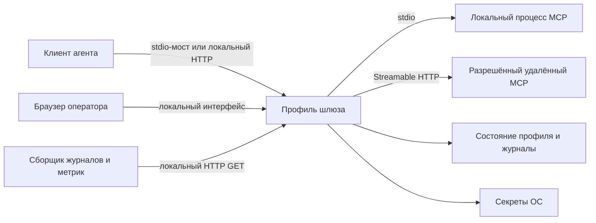

# Архитектура

[English](Architecture.md) · [Главная](Home-ru.md)

Один процесс обслуживает один профиль на loopback. Профиль задаёт серверы, среду, токен, политику инструментов и каталог состояния. Агент может подключиться через `stdio`-мост или Streamable HTTP. Оператор использует браузер, CLI или отдельно включённый MCP Bridge. Внешний сборщик опрашивает локальное API чтения.

При запуске шлюз обнаруживает инструменты и отслеживает изменения каталога. Общий маршрут `/mcp/<ключ-профиля>` публикует имена вида `backend.tool`. Маршрут `/mcp/<ключ-профиля>/<backend>` публикует инструменты выбранного MCP под исходными именами. Шлюз принимает MCP-соединение на loopback и предоставляет доступ к инструментам. Оба маршрута обрабатывают `tools/list` и `tools/call` через общую маршрутизацию и политику шлюза. Перед вызовом проверяется политика. При наличии привязки выполняется локальный хук. Вызов закрепляется за поколением подключения, которое опубликовало инструмент. В разрешённом режиме singleflight одинаковые одновременные вызовы могут разделить одно обращение к MCP. Ответ на диск для повторного использования не сохраняется. Вызовы с контекстом продолжают передаваться отдельно.

Конфигурация находится в переносимом JSON. Значения секретов хранятся в Связке ключей или поступают из явно настроенного окружения. Журналы содержат операционные метаданные. SQLite используется для технических событий, навыков и оценок. Политика и реестр модулей имеют ревизии. Язык браузера влияет на представление.

Текущий сервис публикует инструменты. Ресурсы, промпты и OAuth/SSO требуют отдельной интеграции. Описания и аннотации upstream рассматриваются как входные данные настроенного сервера.
