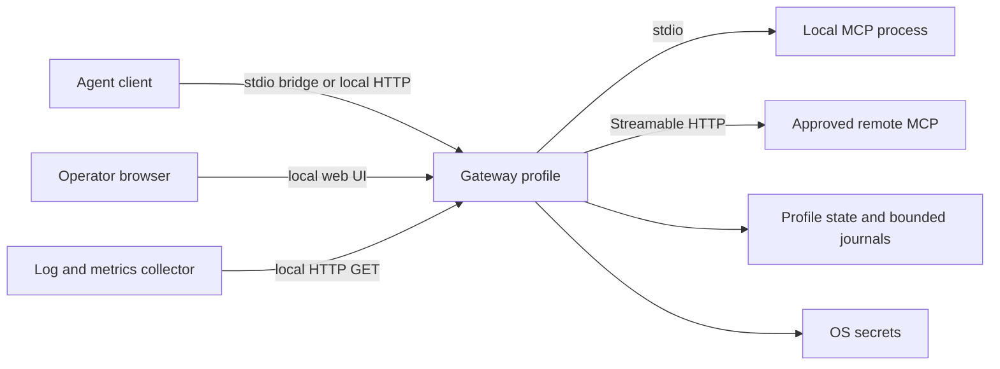

# Architecture

[Русский](Architecture-ru.md) · [Wiki home](Home.md)

One process serves one profile on loopback. Profile selection controls upstreams, environment, token, tool policies and state path. Agents can use the `stdio` client bridge or the profile's Streamable HTTP MCP endpoint. Operators use the browser, CLI or separately enabled MCP Bridge. External collectors poll a local read interface.

At startup the gateway discovers tools, publishes names as `backend.tool` and handles catalog changes. A call is checked against policy, optionally transformed by a local hook, and dispatched using the published connection generation. An allowed singleflight operation can share one upstream call among concurrent identical requests. It has no persistent response cache. Context-bearing calls preserve their independent routing and tracing.

Configuration lives in portable JSON. Keychain or explicitly configured environment variables hold secret values. Journals retain operational metadata. SQLite stores technical events, skills and feedback where enabled. Tool-policy and module changes are revisioned. The browser locale only affects rendering.

The service exposes tools. Other MCP capabilities, such as resources, prompts and OAuth/SSO workflows, require separate integration. Treat annotations and documentation provided by upstreams as input from the configured server.
